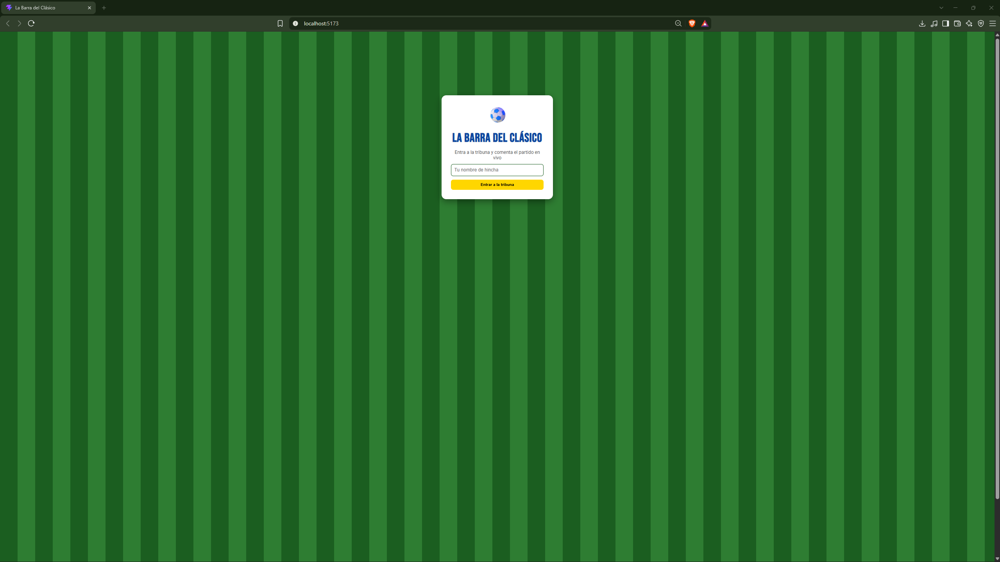
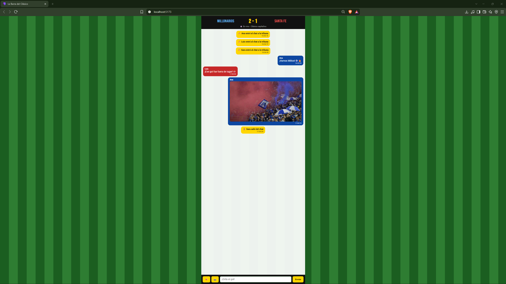

# chat-client

Cliente React (Vite) del chat en vivo **La Barra del Clásico** (DOSW, semana 15). Se conecta al repo [chat-server](../chat-server) por WebSocket usando STOMP (`@stomp/stompjs`) en `ws://localhost:8080/ws`.

## Cómo correrlo

1. Tener Node 20+ y el `chat-server` corriendo en el puerto 8080.
2. `npm install`
3. `npm run dev`
4. Abrir http://localhost:5173 en varias pestañas con nombres distintos.

## Destinos STOMP

| Dirección | Destino |
|---|---|
| Publica al entrar | `/app/chat.unirse` |
| Publica mensajes | `/app/chat.enviar` |
| Se suscribe | `/topic/sala` |

Las imágenes se suben por HTTP a `POST /api/archivos`, y por el WebSocket solo se envía la URL que devuelve el servidor.

## Tema y funciones extra

- **Tema:** "La Barra del Clásico". Fondo de cancha, marcador del partido arriba, burbujas azules (mías) y rojas (de los demás), y avisos de entrada y salida en amarillo.
- **Emojis:** el botón 😄 abre el selector (`emoji-picker-react`).
- **Imágenes:** el botón 📷 sube una foto y todos la ven en el chat.

## Observabilidad

El cliente no tiene observabilidad propia: las métricas, trazas y logs están en el `chat-server`. El README de ese repo explica cómo levantarla y tiene la captura del tablero.
